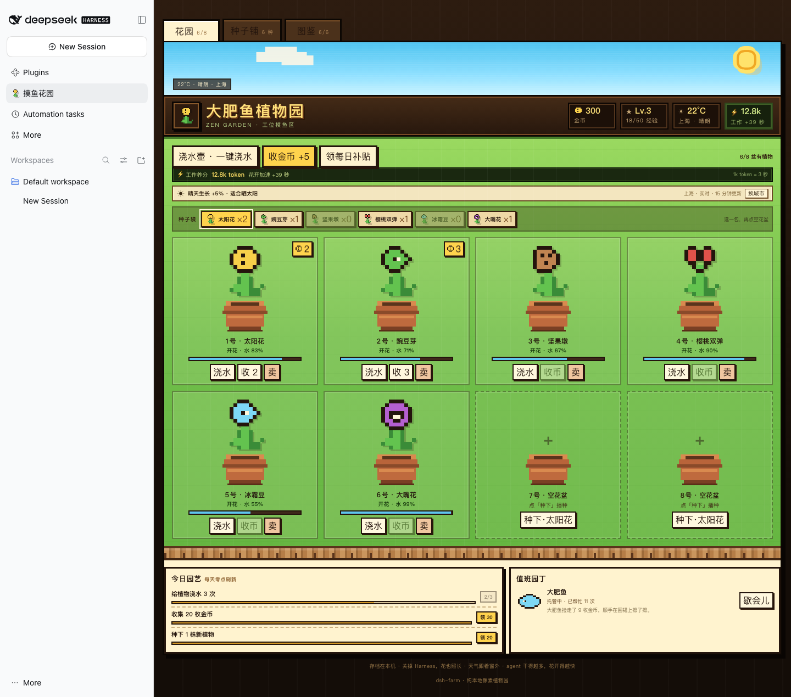

# dsh-zen-garden · Pixel Zen Garden

A desktop-side garden for [DeepSeek Harness](https://github.com/deepseek-ai/deepseek-harness). Open **Plugins → 摸鱼花园** (the sidebar entry) and grow pixel plants while the agent works. The more new tokens the agent processes, the faster the flowers grow.

中文说明见 [README.md](README.md)。



## What it does

- **Eight pots, six plants** — sunflower, peashooter, wall-nut, cherry bomb, snow pea and chomper. Each has its own growth time, water use, coin rate and seed price.
- **Zen-garden loop** — plant, water, wait for the bloom, collect coins, sell a plant, buy more seeds. Daily tasks pay extra coins.
- **Live weather** — reads the current conditions from [Open-Meteo](https://open-meteo.com/) for your local timezone's city. Rain speeds growth and keeps the soil wet; snow slows it down. Switch the city from the weather bar.
- **Big Fat Fish helper** — a local NPC that collects ripe coins and waters the thirstiest plant while you are away.
- **Agent tools** — `garden_status` reports the garden; `garden_action` lets the agent plant, water, collect, buy, sell and claim tasks. The farm keeps growing offline because growth is based on timestamps in a local JSON save.
- **Pixel UI** — hand-drawn SVG-pixel plants, pots, coins, weather and a dark wood HUD. No image assets or external UI library at runtime.

## Install

### From the DSH plugin manager

Install `dsh-zen-garden` from the plugin market, or add this repository / a release tarball through the manager.

### From this repository

```sh
dsh plugin --profile desktop add github:vector985/dsh-zen-garden
```

Or install the prebuilt release tarball:

```sh
dsh plugin --profile desktop add https://github.com/vector985/dsh-zen-garden/releases/latest/download/dsh-zen-garden.tgz
```

Then enable **dsh-zen-garden** and refresh the page. The sidebar entry is called **摸鱼花园**.

### From a tarball

Download `dsh-zen-garden.tgz` from the latest release and choose it in the plugin manager, or:

```sh
dsh plugin --profile desktop add /path/to/dsh-zen-garden.tgz
```

## Using it

- Click a pot, choose a seed from the seed tray, then **种下**.
- Water when the drop icon turns red; plants grow slowly when water is below 50%.
- A bloom produces up to six coins. Press **收币** or let the helper do it.
- The weather bar shows the real temperature, city and condition. **换城市** accepts Chinese or English city names.
- Daily tasks are in the task card; the **种子铺** sells new seeds and the **图鉴** tracks which plants you have grown.

### Weather configuration

```sh
export DSH_FARM_CITY=Shanghai
# or exact coordinates
export DSH_FARM_LAT=31.2304 DSH_FARM_LON=121.4737
```

Without an override, the plugin maps the host timezone to a city (for example `Asia/Shanghai` → Shanghai). If the timezone is unknown it falls back to IP geolocation. Weather is cached for 15 minutes and the last reading is kept when offline.

### Work nutrients

`1,000 new tokens = 3 seconds of growth`. Only uncached input, output and cache-write tokens count; cached context re-reads do not inflate the garden. A single tick is capped at 10 minutes, and excess growth is banked for newly planted seeds. Change `WORK_MS_PER_TOKEN` in `lib/index.js` if you want a different rate.

## Data and privacy

- Save file: `~/.dsh/zen-garden/state.json` (`$DSH_HOME/zen-garden/state.json` when `DSH_HOME` is set; `DSH_FARM_DIR` overrides the directory; the old `farm/state.json` is migrated once).
- Weather requests send only the city coordinates to Open-Meteo — no session content, tokens, account or file paths.
- The plugin has no telemetry, no remote save and no account system. Deleting the JSON file starts a new garden.
- The token meter reads the host's own `tokenUsage` projection; it does not read prompts or message bodies.

## Development

```sh
npm install
npm run check
npm test
```

- `lib/index.js` — host half: save state, growth/coins, weather, HTTP route and agent tools.
- `lib/client.js` — browser half: sidebar entry, pixel rendering and garden UI.
- `cordis.patch.yml` — bundle patch that inserts the package.
- `test/game.test.mjs` — 44 checks covering the game loop, routes, tools and weather.

## Limits

- Single-player and local-only; no cloud sync, multiplayer stealing or leaderboards.
- Weather depends on Open-Meteo. City mapping is approximate; VPN egress can make IP fallback wrong.
- This is a desktop toy, not a game with anti-cheat, limiting or trading.
- Not affiliated with or endorsed by *Plants vs. Zombies*; no original art, audio or levels are included.

## License

MIT
