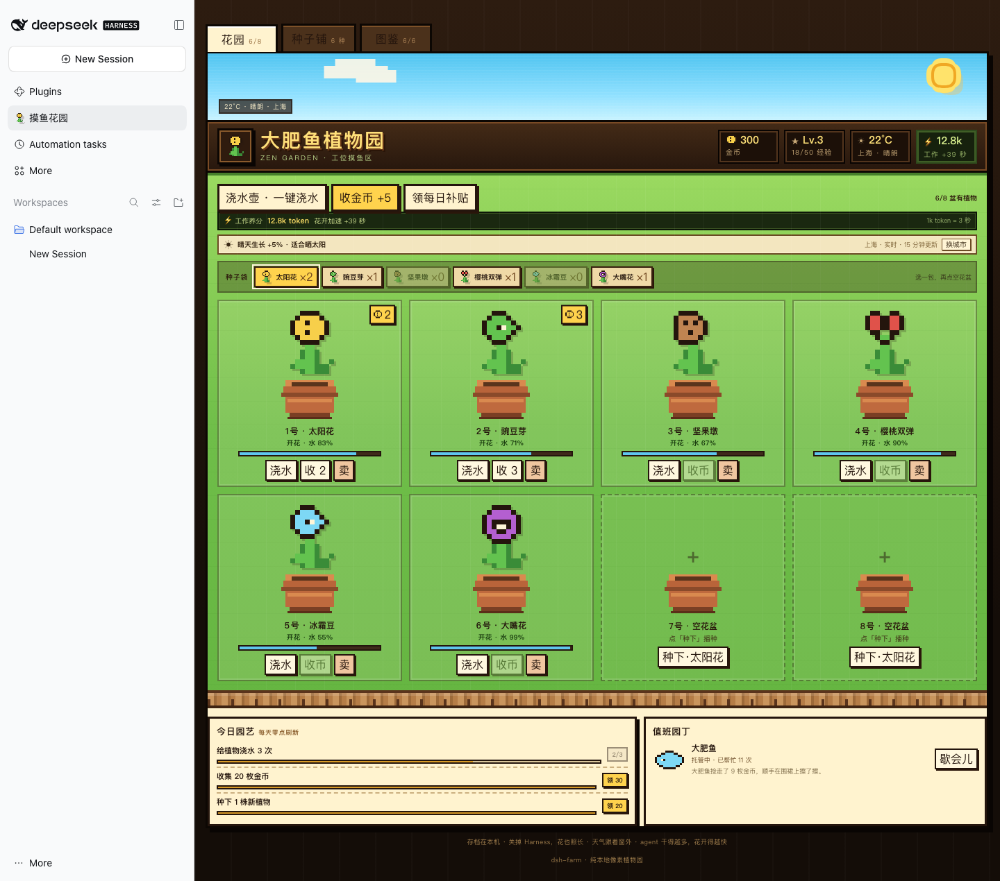

# 大肥鱼植物园 · dsh-zen-garden

[English](README.en.md)

给 DeepSeek Harness 加一座像素风的「禅境花园」。打开左侧栏的「摸鱼花园」，种一盆花、浇点水，看它慢慢开花、掉金币；关掉 Harness，植物也会继续长。

你在 Harness 里干活消耗的 token，会变成植物的「工作养分」：agent 写得越多，花开得越快。植物园还会读取窗外的实时天气，晴天、下雨、下雪都会改变生长节奏。

> 这是给 Harness 用的插件，不是独立网页。装好后入口在侧边栏，和「插件」「自动化任务」并排。
>
> 玩法参考《植物大战僵尸》的禅境花园，但所有像素植物、图标和界面都是原创绘制，不含游戏素材。



## 能玩什么

- **8 个花盆，6 种植物**：太阳花、豌豆芽、坚果墩、樱桃双弹、冰霜豆、大嘴花。从 20 金币的太阳花到 120 金币的大嘴花，越稀有越能攒。
- **真时间生长**：小苗 → 长叶 → 开花。缺水会停止生长；水会随时间蒸发，最多能撑 5 小时。
- **窗外天气**：默认跟随本机时区找到城市，向 Open-Meteo 读取实时温度、湿度与天气代码。晴天长得快一点，雨天少浇水、长得更快，雪天会放慢；每 15 分钟刷新，断网时保留上一次读数并标成离线。也可以点天气条上的「换城市」，手动看另一个城市。
- **工作养分**：Harness 里每消耗 1,000 token，折算成 3 秒生长加速。插件每 8 秒把新消耗的 token 分给正在长、且不缺水的小苗；没有可分的花时先存着，最多存 10 分钟，等新花种下再兑现。
- **开花掉金币**：开花后按植物自己的节奏往花盆里掉金币，单盆最多攒 6 枚。点金币或「收」进钱包；也可以一键收全部。
- **大肥鱼值班**：默认开启托管。它会每 45 秒帮你捡走花盆里的金币，每 3 分钟给最渴的植物浇水；不需要时可以让它「歇会儿」。
- **种子铺与图鉴**：用金币买种子，卖掉不想要的植物。图鉴记录你种过哪些植物；同一种种得越多，收集数量越高。
- **每日园艺**：每天 3 个小任务——浇水 3 次、收 20 枚金币、种 1 株新植物；完成后领 15/30/20 金币。每天还有一次随机补贴。
- **只加速生长，不直接发钱**：token 只让植物更快开花；金币仍要靠花开后慢慢攒，不会因为刷 token 直接进钱包。
- **等级**：种植物、浇水、收金币、领任务都会加经验；Lv.1 起步，每 50 经验升一级。

## 工作养分怎么算

> 这不是云同步，也不上传会话内容；只读取 Harness 已经在本地记录的 token 用量。

- 数据来源：DSH 的 session token 用量投影（`tokenUsage`），统计当前仍打开的会话，包含子 agent。
- 计量方式：按累计用量做差分。插件第一次看到某个会话时只记基线，不补历史；会话关闭后从集合移除。只算新处理的 token（未命中缓存的输入 + 输出 + 缓存写入），重复命中的上下文不重复计入。
- 换算：`1,000 token = 3 秒`生长时间。单轮最多折算 10 分钟，避免一次超大上下文把整座花园瞬间催熟。
- 分配：只给「正在长、且水分 > 15%」的花盆平均分配；快开花的盆只吃自己需要的那一段，余量留到下一位或存进 bank。
- 调节：想改成「1,000 token = 5 秒」，改 `lib/index.js` 里的 `WORK_MS_PER_TOKEN = 5`，再打包装回。

如果宿主没有 token 用量投影，插件仍按真实时间生长，只是少这一层加速。

## 天气从哪来

- 数据源：[Open-Meteo](https://open-meteo.com/)，免 API key；插件只发送城市坐标，不发送会话内容、token 或任何账号信息。
- 默认位置：读本机时区，映射到城市中心（例如 `Asia/Shanghai` → 上海）。时区不在内置表里时，才用 `ipwho.is` 按出口 IP 兜底；VPN 出口可能导致城市不准。
- 手动换城市：点花园天气条右侧的「换城市」，输入中文/英文城市名即可；选择会存进本地存档。
- 环境变量覆盖（重启 Harness 生效）：
  ```sh
  export DSH_FARM_CITY=杭州
  # 或者直接给坐标
  export DSH_FARM_LAT=30.2741 DSH_FARM_LON=120.1551
  ```
- 缓存：成功 15 分钟刷新一次；失败 5 分钟后重试，并保留上次读数。

| 天气 | 生长 | 水分消耗 | 金币 |
| --- | --- | --- | --- |
| 晴 | ×1.05 | ×1 | ×1.05 |
| 多云 / 阴 | ×1 | ×1 | ×1 |
| 雨 | ×1.15 | ×0.35 | ×1 |
| 雷雨 | ×0.95 | ×0.5 | ×0.9 |
| 雪 | ×0.72 | ×0.8 | ×0.9 |
| 雾 | ×0.95 | ×1 | ×1 |

## 给 Agent 用

装好后模型会多出两个工具，可以直接说「大肥鱼，去把金币收了」「给最渴的花浇水」。

| 工具 | 作用 |
| --- | --- |
| `garden_status` | 查看金币、等级、花盆里的植物、开花进度、水分、待收金币、种子、每日任务和托管日志 |
| `garden_action` | 执行 `plant` / `water` / `waterAll` / `collect` / `collectAll` / `buySeed` / `sellPlant` / `gift` / `setSnail` / `claimQuest` |

例子：

> 大肥鱼，看看植物园里谁渴了，顺手把金币收了。

> 帮我种一株坚果墩到 3 号盆，再把今天的园艺任务领了。

工具和侧边栏共用同一份存档；Agent 收的金币会直接出现在界面里。

## 安装

### 方式一：从 GitHub 安装

```sh
dsh plugin --profile desktop add github:vector985/dsh-zen-garden
```

或在插件管理器里选择 **GitHub**，填入 `vector985/dsh-zen-garden`。

### 方式二：从 Release 安装

```sh
dsh plugin --profile desktop add https://github.com/vector985/dsh-zen-garden/releases/latest/download/dsh-zen-garden.tgz
```

### 方式三：插件管理器本地路径（开发用）


1. 打开 Harness 左侧栏的 **插件**。
2. 点 **添加插件**，选择 **本地绝对路径**，填入本目录（在仓库根目录执行 `pwd` 得到）：
   ```
   /path/to/dsh-zen-garden
   ```
3. 安装后点 **启用**，刷新页面。侧边栏会出现「摸鱼花园」。

### 方式四：手动加进 profile

把本目录链接进 profile，并在 `~/.dsh/profiles/desktop/cordis.patch.yml` 末尾加：

```yaml
- id: dsh-zen-garden
  name: dsh-zen-garden
```

然后：

```sh
cd ~/.dsh/profiles/desktop
pnpm install
```

重启 Harness。

### 方式五：从 tarball 安装

```sh
cd /path/to/dsh-zen-garden
npm pack
```

在插件管理器里选择 **tarball**，装生成的 `dsh-zen-garden-0.6.0.tgz`。

## 存档

默认存在本机 JSON：

- `~/.dsh/zen-garden/state.json`
- 设置了 `DSH_HOME`：`$DSH_HOME/zen-garden/state.json`
- 想整体换目录：设置 `DSH_FARM_DIR` 后重启 Harness。

存档是本机单机数据；删掉就会重新开局。旧版菜地存档（v1）会自动换成植物园初始状态；旧的 `~/.dsh/farm/state.json` 会在首次启动时迁移一次。

## 开发

```sh
npm install
npm run check
npm test
```

- `lib/index.js`：Host 半，负责存档、生长/产币、大肥鱼托管、HTTP 路由和 Agent 工具。
- `lib/client.js`：浏览器半，侧边栏入口、像素绘制和花园界面。
- `cordis.patch.yml`：把本包作为 bundle 插进 Host。
- `test/game.test.mjs`：不依赖 Harness 的玩法/路由/工具/天气冒烟测试（44 项）。
- `docs/`：桌面和手机的界面截图。

## 边界

- 单机单人：大肥鱼是本地 NPC，没有云同步、多人互偷或排行榜。
- 不包含《植物大战僵尸》的任何美术、音频或关卡；只是相近的养花循环。
- 这是摸鱼插件，不是链游：没有防作弊、限流或交易系统。
- 实时天气需要能访问 Open-Meteo；完全离线时花园仍会按时间生长，只是天气停在最后一次读数。
- 天气只影响生长、耗水和金币倍率，不会把真实天气写进账号，也不会上传任何 Harness 会话数据。
- token 生长依赖 DSH 的本地会话用量；换 Harness、清会话或宿主不提供投影时，只保留真时间生长。
